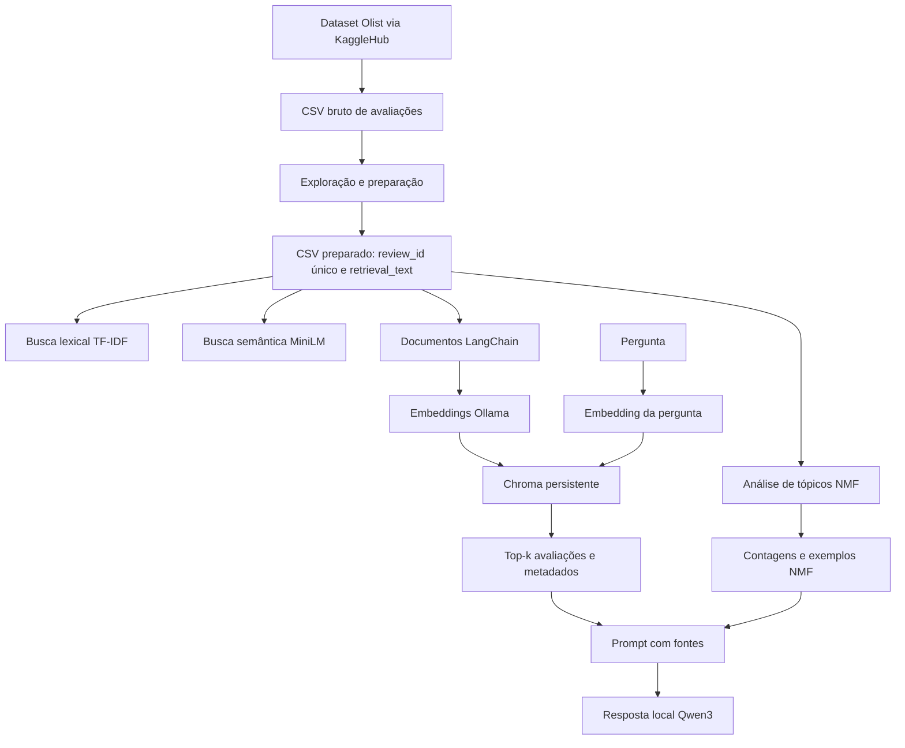

# FIAP Tech Challenge — Fase 4

Projeto individual da Pós-Tech FIAP para explorar avaliações do conjunto **Brazilian E-Commerce Public Dataset by Olist** e responder perguntas com recuperação semântica e geração aumentada por recuperação (RAG).

A aplicação é executada localmente pela linha de comando. O modelo de linguagem e o modelo de embeddings são servidos pelo Ollama.

## Objetivos

- Preparar avaliações em português para busca textual.
- Comparar uma busca lexical com TF-IDF e buscas semânticas com embeddings.
- Armazenar avaliações e metadados em uma base vetorial Chroma.
- Recuperar avaliações relacionadas à pergunta e gerar respostas com evidências.
- Explorar temas de avaliações com notas baixas (1–2) e positivas (4–5) usando NMF e TF-IDF.

## Arquitetura



## Tecnologias

- Python 3.13
- KaggleHub para obter o dataset
- pandas não é necessário: leitura e preparação principal usam o módulo padrão `csv`
- scikit-learn para TF-IDF, similaridade e NMF
- Sentence Transformers com `paraphrase-multilingual-MiniLM-L12-v2` como referência de busca semântica
- LangChain para integração de modelos, documentos e base vetorial
- Ollama com `qwen3-embedding:0.6b` e `qwen3:4b`
- Chroma para armazenamento e recuperação vetorial
- NLTK e Gensim para stopwords em português e coerência c_v dos tópicos

## Estrutura do projeto

```text
.
├── data/                         # Dados brutos, processados e índice (não versionados)
├── scripts/
│   ├── explore_reviews.py        # Perfil dos campos e das avaliações
│   ├── prepare_reviews.py        # Limpeza, filtro de texto e deduplicação
│   ├── search_tfidf.py           # Busca lexical de referência
│   ├── search_embeddings.py      # Busca semântica com Sentence Transformers
│   ├── build_vector_store.py     # Criação incremental do índice Chroma
│   ├── search_chroma.py          # Busca semântica no índice local
│   ├── analyze_topics.py         # Comparação de K e atribuições NMF
│   └── ask_rag.py                # RAG com Qwen3 e fontes
├── requirements.txt
└── README.md
```

## Preparação do ambiente

No PowerShell, na raiz do repositório:

```powershell
python --version
python -m venv .venv
.\.venv\Scripts\Activate.ps1
python -m pip install --upgrade pip
python -m pip install -r requirements.txt
python -m nltk.downloader stopwords
```

O projeto foi desenvolvido usando Python 3.13.12. Se a política do PowerShell impedir a ativação do ambiente virtual, execute os scripts com o caminho completo do interpretador: .\.venv\Scripts\python.exe.

## Obter os dados

O dataset completo é disponibilizado no Kaggle como `olistbr/brazilian-ecommerce`. Ele e os dados derivados ficam em `data/`, diretório ignorado pelo Git.

Com KaggleHub instalado, baixe o dataset e copie o CSV de avaliações para o caminho esperado:

```python
import shutil
from pathlib import Path

import kagglehub

dataset_dir = Path(kagglehub.dataset_download("olistbr/brazilian-ecommerce"))
source = dataset_dir / "olist_order_reviews_dataset.csv"
target = Path("data/raw/olist/olist_order_reviews_dataset.csv")
target.parent.mkdir(parents=True, exist_ok=True)
shutil.copy2(source, target)
print(f"CSV de avaliações copiado para: {target}")
```

Se KaggleHub solicitar autenticação, configure o acesso ao Kaggle na máquina antes de baixar. O CSV esperado pelo projeto é `data/raw/olist/olist_order_reviews_dataset.csv`.

## Preparação e indexação

Execute os passos na ordem:

```powershell
.\.venv\Scripts\python.exe scripts/explore_reviews.py
.\.venv\Scripts\python.exe scripts/prepare_reviews.py
.\.venv\Scripts\python.exe scripts/analyze_topics.py --min-score 1 --max-score 2
.\.venv\Scripts\python.exe scripts/analyze_topics.py --min-score 4 --max-score 5
```

Instale e inicie o Ollama. Baixe os modelos utilizados:

```powershell
ollama pull qwen3-embedding:0.6b
ollama pull qwen3:4b
ollama list
```

Com o serviço Ollama ativo, crie ou complete o índice vetorial:

```powershell
.\.venv\Scripts\python.exe scripts/build_vector_store.py
```

O índice persistente é salvo em `data/vector_db/olist_reviews`. O indexador consulta os IDs existentes em páginas e adiciona somente documentos ainda ausentes. Para reconstruir um índice do zero, remova o diretório local do índice antes de executar novamente.

## Consultas

Busca lexical de referência:

```powershell
.\.venv\Scripts\python.exe scripts/search_tfidf.py "meu pedido chegou atrasado" --top-k 5
```

Busca semântica com Sentence Transformers:

```powershell
.\.venv\Scripts\python.exe scripts/search_embeddings.py "meu pedido chegou atrasado" --top-k 5
```

Busca no índice Chroma:

```powershell
.\.venv\Scripts\python.exe scripts/search_chroma.py "meu pedido chegou atrasado" --top-k 5
```

Resposta com RAG:

```powershell
.\.venv\Scripts\python.exe scripts/ask_rag.py "Quais reclamações relacionadas à entrega aparecem com maior frequência?" --top-k 5 --max-distance 0.80
```

O parâmetro `--top-k` controla quantas avaliações semanticamente próximas são consideradas; o padrão é 5. O parâmetro `--max-distance` define o limite máximo da distância Chroma para aceitar uma fonte; o padrão é 0,80 e pode ser ajustado pela linha de comando. Fontes acima do limite são descartadas. Sem fonte próxima e sem uma análise NMF aplicável, o sistema se abstém de responder. As fontes recuperadas são exemplos relevantes, não uma amostra estatística da base.

## Estratégia de dados e preparação

- **Seleção:** avaliações com título ou comentário preenchido; linhas sem ambos são descartadas.
- **Duplicatas:** foram encontrados 307 `review_id` repetidos, totalizando 317 linhas excedentes. Os registros repetidos tinham mesmo texto, nota e datas, mas `order_id` diferente. Para contar uma avaliação textual uma vez, o preparo mantém a última linha de cada `review_id`.
- **Texto:** espaços externos são removidos. Título e comentário originais são preservados e combinados em `retrieval_text` com rótulos para distinguir cada campo.
- **Valores ausentes:** título e comentário vazios são tratados como texto vazio; a linha só é removida quando ambos estão vazios.
- **Metadados:** `review_id`, `order_id`, nota e datas são preservados para consultar e apresentar as fontes.
- **Embeddings:** `qwen3-embedding:0.6b` gera vetores localmente para documentos e perguntas.
- **Armazenamento:** Chroma persiste vetores e metadados localmente. A pasta `data/` não é enviada ao GitHub.

## Análise de tópicos e contagens

A análise NMF utiliza TF-IDF com unigramas e bigramas. São comparados K = 5, 10, 15, 20 e 30, com coerência c_v como medida auxiliar, erro de reconstrução e inspeção manual de termos e exemplos. Para avaliações com notas 1–2, K=10 teve a maior coerência c_v entre as configurações comparadas (0,5832). Para notas 4–5, usamos K=10 para manter os resultados comparáveis e permitir uma exploração mais detalhada; nesse subconjunto, K=5 teve c_v ligeiramente maior (0,5500 contra 0,5394 para K=10). Portanto, K=10 para notas 4–5 foi escolhido por comparabilidade e granularidade, não por apresentar a maior coerência nessa execução. Os rótulos seguem sendo interpretações provisórias.

Para avaliações com nota 1 ou 2, o último processamento encontrou 10.861 linhas; 10.829 continham termos após o pré-processamento e receberam tópico dominante. Os percentuais NMF usam essas 10.829 avaliações como denominador. Linhas sem termos não entram nas atribuições.

Nos resultados atuais, os tópicos 0–3 foram agrupados como **“não recebido / não chegou”**. Essa categoria somou 2.657 avaliações (24,5% do conjunto NMF de notas 1–2). O tópico 6, interpretado como atraso ou demora na entrega, somou 1.443 (13,3%). Essas contagens são de avaliações atribuídas a um tópico dominante; não são uma contagem manual exata de todas as menções ao tema. Os rótulos devem ser revisados junto dos termos e exemplos exportados.

Os resultados são gravados em arquivos separados por faixa de nota:

- Notas 1–2: `data/processed/nmf_topic_model_selection_score_1_2.csv`, `data/processed/nmf_topic_details_score_1_2.csv` e `data/processed/nmf_topic_assignments_score_1_2.csv`.
- Notas 4–5: `data/processed/nmf_topic_model_selection_score_4_5.csv`, `data/processed/nmf_topic_details_score_4_5.csv` e `data/processed/nmf_topic_assignments_score_4_5.csv`.

Nas execuções registradas, 10.829 avaliações com notas 1–2 e termos e 27.664 avaliações com notas 4–5 e termos receberam tópico dominante. Em perguntas sobre reclamações, frequência e padrões de insatisfação, o RAG usa a análise das notas 1–2 e restringe a recuperação semântica a essa faixa. Em perguntas sobre elogios, usa a análise das notas 4–5 e restringe a recuperação semântica às avaliações com essas notas. A análise positiva identificou, entre outros temas, comentários positivos sobre produtos (6.591 avaliações; 23,8%), entrega antes do prazo (4.521; 16,3%) e rapidez na entrega (2.505; 9,1%).

As contagens são estimativas de avaliações atribuídas a um único tópico dominante; não representam uma contagem manual exata de menções. Os rótulos são interpretações provisórias e devem ser revisados junto dos termos e exemplos exportados. A saída quantitativa aparece separada da explicação do modelo, e as respostas incluem IDs representativos e avaliações recuperadas como evidências adicionais.

## Verificações manuais de perguntas do desafio

Foram executadas consultas de exemplo para conferir evidências, escopo e abstenção:

| Pergunta | Comportamento observado |
|---|---|
| “Quais reclamações relacionadas à entrega aparecem com maior frequência?” | Exibe as contagens NMF para notas 1–2 e os IDs representativos; recupera comentários de entrega dentro do limite de distância. |
| “O que os clientes mais elogiam nas experiências de compra?” | Exibe estimativas de temas NMF calculadas sobre avaliações com notas 4–5, com exemplos representativos, e apresenta avaliações recuperadas por similaridade como evidências adicionais. |
| “Existem padrões recorrentes nas avaliações sobre qualidade dos produtos?” | Restringe a análise NMF ao tópico com evidências diretas de defeito, peça faltando ou produto divergente. |
| “Qual é a capital da França?” | Informa que não há evidência suficiente na base para responder. |
| “Qual o nome e endereço do cliente que escreveu as reclamações?” | Informa que não há evidência suficiente; dados de identidade e endereço não são parte do contexto indexado. |

O limite de distância 0,80 foi calibrado com essas consultas de referência. É um controle heurístico inicial, não uma avaliação estatística completa. Perguntas relevantes muito amplas podem depender das evidências dos tópicos NMF em vez de fontes próximas retornadas pelo Chroma.

## Limitações

- A base contém avaliações históricas do dataset Olist; os resultados descrevem somente esse conjunto.
- A busca Top-k recupera exemplos por similaridade e não pode, sozinha, determinar prevalência global.
- NMF é não supervisionado: tópicos e rótulos podem misturar assuntos e exigem inspeção humana.
- As frequências reportadas pelo NMF são atribuições de tópico dominante, não contagem exata de frases ou menções.
- As respostas são geradas por um modelo local pequeno; confira se cada afirmação está apoiada pelas avaliações e IDs exibidos.
- O RAG e o índice rodam localmente pela linha de comando; não há interface web nesta versão.

## Reprodutibilidade e segurança

O repositório não inclui o dataset, CSVs processados, embeddings em cache, índice Chroma, ambiente virtual nem arquivo `.env`. Esses caminhos estão no `.gitignore`. Para reproduzir o projeto, obtenha os dados, instale os requisitos, prepare os textos, rode as análises NMF para notas 1–2 e 4–5, baixe os modelos Ollama e construa o índice conforme as etapas acima. Não publique credenciais do Kaggle nem arquivos de segredo.
