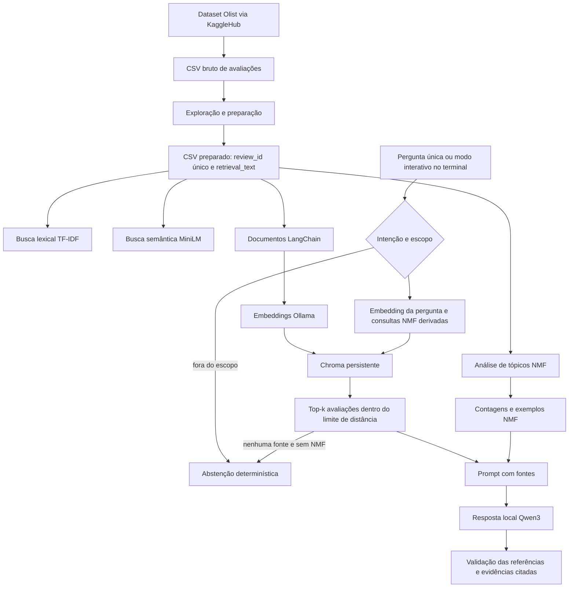

# FIAP Tech Challenge - Fase 4

Desafio para criar uma solução em IA, transformando uma base de dados em uma base de conhecimento inteligente. Vamos explorar avaliações do conjunto **Brazilian E-Commerce Public Dataset by Olist** e responder perguntas com recuperação semântica e geração aumentada por recuperação (RAG).

A aplicação é executada localmente pela linha de comando. O modelo de linguagem e o modelo de embeddings são servidos pelo Ollama.

## Objetivos

- Preparar avaliações em português para busca textual.
- Comparar uma busca lexical com TF-IDF e buscas semânticas com embeddings.
- Armazenar avaliações e metadados em uma base vetorial Chroma.
- Recuperar avaliações relacionadas à pergunta e gerar respostas com evidências.
- Explorar temas de avaliações com notas baixas (1–2) e positivas (4–5) usando NMF e TF-IDF.

## Arquitetura



### Fluxo de uma pergunta

1. **Processamento da pergunta:** indicadores textuais identificam a intenção (reclamações, elogios, causa, dados pessoais). Perguntas temáticas passam por um classificador de escopo com o Qwen3; perguntas de outro domínio recebem abstenção imediata.
2. **Transformação:** perguntas temáticas são expandidas com consultas derivadas dos temas NMF relevantes, e a faixa de nota vira filtro (1–2 para insatisfação, 4–5 para elogios).
3. **Representação vetorial:** a pergunta e as consultas derivadas são convertidas em embeddings com `qwen3-embedding:0.6b`.
4. **Recuperação e seleção:** o Chroma retorna as avaliações mais próximas; fontes acima da distância 0,80 são descartadas, duplicatas são removidas e os resultados das consultas são intercalados (round-robin) até o top-k.
5. **Construção do contexto:** as fontes numeradas (`[Fonte n]`) e os exemplos NMF numerados (`[NMF n]`) são enviados ao modelo com instruções de fundamentação.
6. **Geração e validação:** o `qwen3:4b` gera a síntese; o programa remove referências inexistentes e frases factuais sem citação, e exibe os `review_id` das evidências citadas.

## Tecnologias

- Python 3.13
- KaggleHub para obter o dataset
- scikit-learn para TF-IDF, similaridade e NMF
- Sentence Transformers com `paraphrase-multilingual-MiniLM-L12-v2` como referência de busca semântica
- LangChain para integração de modelos, documentos e base vetorial (versões diretas fixadas em `requirements.txt`)
- Ollama com `qwen3-embedding:0.6b` e `qwen3:4b`
- Chroma para armazenamento e recuperação vetorial
- NLTK e Gensim para stopwords em português e coerência c_v dos tópicos

## Decisões técnicas

- **Qwen3 4B:** modelo local disponível pelo Ollama, sem chave de API e adequado ao hardware usado no desenvolvimento. Um modelo pequeno pode produzir respostas menos consistentes; por isso, o pipeline limita o contexto, valida referências e exibe as evidências.
- **Qwen3 Embedding 0.6B:** gera localmente vetores para documentos e perguntas com o mesmo modelo, mantendo a busca semântica reproduzível no ambiente configurado.
- **Chroma:** persiste o índice localmente e permite recuperar documentos junto de metadados e filtros de nota.
- **Top-k 5:** limite inicial para mostrar um conjunto pequeno de comentários por pergunta e manter o contexto do modelo manejável; não é uma exigência do desafio nem um valor universal.
- **Distância máxima 0,80:** corte heurístico aplicado às distâncias Chroma (menor significa mais próximo), ajustado por inspeção de consultas de exemplo. Não foi calibrado como limiar estatístico e pode rejeitar perguntas válidas quando a recuperação direta é fraca; a expansão NMF tenta acrescentar buscas temáticas sem remover esse corte.
- **Dependências:** `requirements.txt` fixa as versões diretas usadas no ambiente atual, incluindo scikit-learn, cuja versão pode alterar a ordem dos tópicos NMF e invalidar rótulos fixos.

## Estrutura do projeto

```text
.
├── data/                         # Dados brutos, processados e índice (não versionados)
├── scripts/
│   ├── explore_reviews.py        # Perfil dos campos e das avaliações
│   ├── prepare_reviews.py        # Limpeza, filtro de texto e deduplicação
│   ├── search_tfidf.py           # Busca lexical de referência
│   ├── search_embeddings.py      # Busca semântica com Sentence Transformers
│   ├── build_vector_store.py     # Criação incremental do índice Chroma
│   ├── search_chroma.py          # Busca semântica no índice local
│   ├── analyze_topics.py         # Comparação de K e atribuições NMF
│   ├── evaluate_retrieval.py     # Inspeção e avaliação manual da recuperação
│   └── ask_rag.py                # RAG com Qwen3, evidências e modo interativo
├── evaluation/
│   ├── retrieval_cases.csv       # Perguntas de avaliação e justificativas
│   └── retrieval_judgments.csv    # Julgamentos manuais de relevância
├── requirements.txt
└── README.md
```

## Preparação do ambiente

No PowerShell, na raiz do repositório:

```powershell
python --version
python -m venv .venv
.\.venv\Scripts\Activate.ps1
python -m pip install --upgrade pip
python -m pip install -r requirements.txt
python -m nltk.downloader stopwords
```

Em Linux ou macOS, ative o ambiente com `source .venv/bin/activate` e use `python` no lugar de `.\.venv\Scripts\python.exe` nos comandos abaixo.

O projeto foi desenvolvido usando Python 3.13.12. Se a política do PowerShell impedir a ativação do ambiente virtual, execute os scripts com o caminho completo do interpretador: .\.venv\Scripts\python.exe.

## Obter os dados

O dataset completo é disponibilizado no Kaggle como `olistbr/brazilian-ecommerce`. Os dados derivados ficam em `data/`, diretório ignorado pelo Git.

Com KaggleHub instalado, baixe o dataset e copie o CSV de avaliações para o caminho esperado:

```python
import shutil
from pathlib import Path

import kagglehub

dataset_dir = Path(kagglehub.dataset_download("olistbr/brazilian-ecommerce"))
source = dataset_dir / "olist_order_reviews_dataset.csv"
target = Path("data/raw/olist/olist_order_reviews_dataset.csv")
target.parent.mkdir(parents=True, exist_ok=True)
shutil.copy2(source, target)
print(f"CSV de avaliações copiado para: {target}")
```

Se KaggleHub solicitar autenticação, configure o acesso ao Kaggle na máquina antes de baixar. O CSV esperado pelo projeto é `data/raw/olist/olist_order_reviews_dataset.csv`.

## Preparação e indexação

Execute os passos na ordem:

```powershell
.\.venv\Scripts\python.exe scripts/explore_reviews.py
.\.venv\Scripts\python.exe scripts/prepare_reviews.py
.\.venv\Scripts\python.exe scripts/analyze_topics.py --min-score 1 --max-score 2
.\.venv\Scripts\python.exe scripts/analyze_topics.py --min-score 4 --max-score 5
```

Instale e inicie o Ollama. Baixe os modelos utilizados:

```powershell
ollama pull qwen3-embedding:0.6b
ollama pull qwen3:4b
ollama list
```

Com o serviço Ollama ativo, crie ou complete o índice vetorial:

```powershell
.\.venv\Scripts\python.exe scripts/build_vector_store.py
```

O índice persistente é salvo em `data/vector_db/olist_reviews`. O indexador consulta os IDs existentes em páginas e adiciona somente documentos ainda ausentes. Para reconstruir um índice do zero, remova o diretório local do índice antes de executar novamente.

## Consultas

Busca lexical de referência:

```powershell
.\.venv\Scripts\python.exe scripts/search_tfidf.py "meu pedido chegou atrasado" --top-k 5
```

Busca semântica com Sentence Transformers:

```powershell
.\.venv\Scripts\python.exe scripts/search_embeddings.py "meu pedido chegou atrasado" --top-k 5
```

Busca no índice Chroma:

```powershell
.\.venv\Scripts\python.exe scripts/search_chroma.py "meu pedido chegou atrasado" --top-k 5
```

Resposta com RAG:

```powershell
.\.venv\Scripts\python.exe scripts/ask_rag.py "Quais reclamações relacionadas à entrega aparecem com maior frequência?" --top-k 5 --max-distance 0.80
```

O parâmetro `--top-k` controla quantas avaliações semanticamente próximas são consideradas; o padrão é 5. O parâmetro `--max-distance` define o limite máximo da distância Chroma para aceitar uma fonte; o padrão é 0,80 e pode ser ajustado pela linha de comando. Fontes acima do limite são descartadas. Sem fonte próxima e sem uma análise NMF aplicável, o sistema se abstém de responder. As fontes recuperadas são exemplos relevantes, não uma amostra estatística da base.

Para usar o programa em modo interativo, sem passar a pergunta no comando:

```powershell
.\.venv\Scripts\python.exe scripts/ask_rag.py
```

O programa aguarda uma pergunta em `Pergunta>`, responde em seções separadas de resposta e evidências citadas e então aguarda outra, sem repetir o texto da pergunta. Digite `sair` para encerrar. O modo de pergunta única mostrado acima também continua disponível.

Por padrão, a saída apresenta uma síntese em linguagem natural e somente as evidências citadas nela. Use `--verbose` para imprimir as consultas transformadas, a análise NMF completa, o mapeamento completo dos exemplos e todas as fontes recuperadas.

A recuperação sempre tenta a pergunta original no Chroma. Antes de expandir uma pergunta temática ou positiva com consultas NMF, o Qwen3 classifica se ela pertence ao escopo das avaliações de compras da Olist. Perguntas explicitamente sobre outro domínio recebem uma abstenção determinística; pedidos gerais sobre padrões e evidências dos comentários são tratados como perguntas sobre a base. Se o classificador não retornar um JSON válido, uma regra de palavras-chave decide o escopo: domínios externos conhecidos são recusados e termos típicos de avaliações (pedido, entrega, produto, reclamação etc.) são aceitos. Se nem essa regra decidir, a busca usa somente a pergunta original, sem expansão NMF.

Perguntas temáticas amplas. Por exemplo: sobre frequência, padrões, reclamações, insatisfação ou evidências, podem acionar a análise NMF e buscas derivadas dos temas relevantes e de comentários representativos. Esse encaminhamento combina os temas correspondentes quando a pergunta aborda vários assuntos. Reclamações e padrões de insatisfação, usam avaliações com notas 1–2; elogios, notas 4–5. Menções a atendimento, resposta ou contato adicionam uma consulta sobre suporte ao cliente. Quando aplicável, o Chroma filtra por nota, remove duplicatas por `review_id` e seleciona os resultados das consultas em rodízio para diversificar o contexto. Perguntas que mencionam entrega rápida são roteadas para os temas positivos, a menos que o texto indique negação.

A resposta deve tratar cada assunto citado na pergunta com evidências correspondentes e usar aspas somente para reproduzir trechos literais. O modelo roda com `reasoning=False`; o programa também remove qualquer bloco `<think>` que apareça. A síntese cita comentários recuperados como `[Fonte n]` e exemplos NMF como `[NMF n]`. Frases factuais sem referências válidas são removidas, mas frases explícitas de insuficiência são preservadas mesmo sem citação. No modo padrão, o programa mostra os `review_id` e comentários correspondentes às referências citadas; `--verbose` mostra o mapeamento completo. A distância máxima padrão é 0,80 e funciona como limite heurístico: se nenhuma fonte passar pelo limite e não houver análise NMF aplicável, o sistema se abstém. Fontes próximas são exemplos, não uma amostra estatística da base; a pertinência das citações ainda requer inspeção humana.

## Estratégia de dados e preparação

- **Seleção:** avaliações com título ou comentário preenchido; linhas sem ambos são descartadas.
- **Duplicatas:** foram encontrados 307 `review_id` repetidos, totalizando 317 linhas excedentes. Os registros repetidos tinham mesmo texto, nota e datas, mas `order_id` diferente. Para contar uma avaliação textual uma vez, o preparo mantém a última linha de cada `review_id`.
- **Texto:** espaços externos são removidos. Título e comentário originais são preservados e combinados em `retrieval_text` com rótulos para distinguir cada campo. Não removemos comentários curtos ou normalizamos o texto exibido, para preservar a evidência tal como foi escrita; isso pode manter ruídos e quebras internas.
- **Valores ausentes:** título e comentário vazios são tratados como texto vazio; a linha só é removida quando ambos estão vazios.
- **Metadados:** `review_id`, `order_id`, nota e datas são preservados. A nota é usada como filtro nas análises de elogios e insatisfação; datas e `order_id` ficam disponíveis para rastreabilidade, mas não são filtros nesta versão. Categoria de produto e atributos de entrega adicionais não foram integrados ao RAG, então o desafio extra está implementado parcialmente.
- **Embeddings:** `qwen3-embedding:0.6b` gera vetores localmente para documentos e perguntas.
- **Armazenamento:** Chroma persiste vetores e metadados localmente. A pasta `data/` não é enviada ao GitHub.

## Análise de tópicos e contagens

A análise NMF utiliza TF-IDF com unigramas e bigramas. São comparados K = 5, 10, 15, 20 e 30, com coerência c_v como medida auxiliar, erro de reconstrução e inspeção manual de termos e exemplos. Para avaliações com notas 1–2, K=10 teve a maior coerência c_v entre as configurações comparadas (0,5832). Para notas 4–5, usamos K=10 para manter os resultados comparáveis e permitir uma exploração mais detalhada; nesse subconjunto, K=5 teve c_v ligeiramente maior (0,5500 contra 0,5394 para K=10). Portanto, K=10 para notas 4-5 foi escolhido por comparabilidade e granularidade, não por apresentar a maior coerência nessa execução. Os rótulos seguem sendo interpretações provisórias.

Para avaliações com nota 1 ou 2, o último processamento encontrou 10.861 linhas; 10.829 continham termos após o pré-processamento e receberam tópico dominante. Os percentuais NMF usam essas 10.829 avaliações como denominador. Linhas sem termos não entram nas atribuições.

Nos resultados atuais, os tópicos 0–3 foram agrupados como **“não recebido / não chegou”**. Essa categoria somou 2.657 avaliações (24,5% do conjunto NMF de notas 1–2). O tópico 6, interpretado como atraso ou demora na entrega, somou 1.443 (13,3%). Essas contagens são de avaliações atribuídas a um tópico dominante; não são uma contagem manual exata de todas as menções ao tema. Os rótulos devem ser revisados junto dos termos e exemplos exportados.

Os resultados são gravados em arquivos separados por faixa de nota:

- Notas 1–2: `data/processed/nmf_topic_model_selection_score_1_2.csv`, `data/processed/nmf_topic_details_score_1_2.csv` e `data/processed/nmf_topic_assignments_score_1_2.csv`.
- Notas 4–5: `data/processed/nmf_topic_model_selection_score_4_5.csv`, `data/processed/nmf_topic_details_score_4_5.csv` e `data/processed/nmf_topic_assignments_score_4_5.csv`.

Nas execuções registradas, 10.829 avaliações com notas 1–2 e termos e 27.664 avaliações com notas 4–5 e termos receberam tópico dominante. Em perguntas sobre reclamações, frequência e padrões de insatisfação, o RAG usa a análise das notas 1–2 e restringe a recuperação semântica a essa faixa. Em perguntas sobre elogios, usa a análise das notas 4–5 e restringe a recuperação semântica às avaliações com essas notas. A análise positiva identificou, entre outros temas, comentários positivos sobre produtos (6.591 avaliações; 23,8%), entrega antes do prazo (4.521; 16,3%) e rapidez na entrega (2.505; 9,1%).

As contagens são estimativas de avaliações atribuídas a um único tópico dominante; não representam uma contagem manual exata de menções. Os rótulos são interpretações provisórias e devem ser revisados junto dos termos e exemplos exportados. No modo padrão, a resposta prioriza a síntese e as evidências citadas; `--verbose` exibe a distribuição quantitativa completa, os exemplos NMF e todas as fontes recuperadas.

## Verificações manuais de perguntas do desafio

Foram executadas consultas de exemplo para conferir evidências, escopo e abstenção:

| Pergunta | Comportamento observado |
|---|---|
| “Quais reclamações relacionadas à entrega aparecem com maior frequência?” | Sintetiza temas NMF de avaliações com notas 1–2 e apresenta evidências citadas; contagens e distribuição completas ficam disponíveis com `--verbose`. |
| “O que os clientes mais elogiam nas experiências de compra?” | Sintetiza temas NMF de avaliações com notas 4–5 e apresenta evidências citadas; contagens e distribuição completas ficam disponíveis com `--verbose`. |
| “Quais são os principais motivos de insatisfação dos clientes?” | Aciona os temas NMF de notas 1–2 e apresenta exemplos para não recebimento, pedidos incompletos, atrasos e defeitos. |
| “Quais padrões podem ser identificados em relatos relacionados à entrega?” | Usa temas NMF relacionados à entrega e comentários recuperados sobre não recebimento e atraso. |
| “Quais padrões podem ser identificados em relatos relacionados à entrega, qualidade dos produtos ou atendimento?” | Combina tópicos NMF de entrega e qualidade e acrescenta uma busca específica de comentários sobre atendimento e falta de resposta. |
| “Quais evidências presentes nos comentários sustentam determinado insight?” | Para a pergunta ampla sem um insight nomeado, apresenta padrões como exemplos e liga a síntese a referências NMF e comentários recuperados. |
| “Existem padrões recorrentes nas avaliações sobre qualidade dos produtos?” | Restringe a análise NMF ao tópico com evidências diretas de defeito, peça faltando ou produto divergente. |
| “Qual transportadora causou o atraso?” | Não confirma uma causa com base em relatos; apresenta os comentários como percepções dos clientes. |
| “Qual é a capital da França?” | Informa que não há evidência suficiente na base para responder. |
| “Quais padrões existem no mercado de ações brasileiro?” | Classifica a pergunta fora do escopo da base Olist e se abstém antes da expansão NMF. |
| “O que os críticos elogiam no filme Oppenheimer?” | Classifica a pergunta fora do escopo e se abstém; o elogio não aciona a análise NMF positiva. |
| “Quais evidências sustentam que a entrega é rápida?” | Reconhece a formulação positiva e seleciona temas de entrega para notas 4–5. |
| “Qual o nome e endereço do cliente que escreveu as reclamações?” | Informa que não há evidência suficiente; dados de identidade e endereço não são parte do contexto indexado. |

O limite de distância 0,80 é um controle heurístico inicial, não uma avaliação estatística completa. Perguntas amplas podem depender da análise NMF e das consultas temáticas; a detecção de intenção é baseada em indicadores textuais e pode exigir ajustes quando uma paráfrase não ativa a análise temática.

## Exemplos de perguntas e respostas

Saídas reais do `ask_rag.py` no modo padrão, que mostra a síntese e somente as evidências citadas. Com `--verbose`, a saída inclui também as consultas derivadas, a distribuição NMF completa e todas as fontes recuperadas.

**Padrões de insatisfação**

```text
Pergunta> Quais problemas são relatados por clientes insatisfeitos?

========================================================================
RESPOSTA | qwen3:4b
Entre os temas identificados estão não recebido / não chegou [NMF 1] e pedido incompleto (faltam itens) [NMF 2]. Os comentários incluem “Não recebi” [NMF 1] e “Comprei dois produtos e recebi apenas um” [NMF 2].

EVIDÊNCIAS CITADAS
- Exemplo NMF 1 | review_id 515f9b87972d61cb787cc44fa41eeddb: Não recebi
- Exemplo NMF 2 | review_id 7791b069b631653faff166a056ca7ec2: Comprei dois produtos e recebi apenas um
========================================================================
```

**Tema específico: qualidade dos produtos**

```text
Pergunta> Existem padrões recorrentes nas avaliações relacionadas à qualidade dos produtos?

========================================================================
RESPOSTA | qwen3:4b
Entre os temas identificados estão produto com defeito, peça faltando ou produto divergente [NMF 1] e produto não recebido ou produto diferente [NMF 2]. Os comentários incluem “O produto veio com defeito !” [NMF 1] e “Produto erredo Recebi o produto erredo” [NMF 2].

EVIDÊNCIAS CITADAS
- Exemplo NMF 1 | review_id f91978f4a01c8e97897adb8f282833c5: O produto veio com defeito !
- Exemplo NMF 2 | review_id ad844b27d07c66f6443ab62db7c0d37c: Produto erredo Recebi o produto erredo
========================================================================
```

**Pergunta fora do escopo**

```text
Pergunta> Porquê chinchilas não dominaram o mundo?

========================================================================
RESPOSTA
Este assistente responde perguntas sobre avaliações de compras da Olist. A pergunta apresentada está fora desse escopo.
========================================================================
```

**Sem evidência suficiente**

```text
Pergunta> Qual é a capital da França?

========================================================================
RESPOSTA
Nenhuma fonte ficou dentro do limite de distância 0.80. Não há evidência suficiente para responder.
========================================================================
```

Os `review_id` exibidos permitem localizar cada avaliação no CSV original e conferir se a síntese corresponde ao que o cliente escreveu.

## Avaliação da recuperação semântica

A pasta `evaluation/` contém perguntas de referência e julgamentos manuais dos resultados. O avaliador reutiliza a função de recuperação do `ask_rag.py`, incluindo filtros de nota, transformação temática NMF quando aplicável, limite de distância e seleção round-robin. Assim, a inspeção representa o fluxo usado pelo RAG.

Com o índice Chroma construído e o Ollama ativo, gere/inspecione os candidatos:

```powershell
.\.venv\Scripts\python.exe scripts/evaluate_retrieval.py --top-k 5 --max-distance 0.80
```

Para cada consulta, classifique os comentários recuperados no arquivo `evaluation/retrieval_judgments.csv`: `relevant=1` para relevante e `relevant=0` para não relevante. O script calcula Precisão@5 somente quando todos os resultados daquela consulta têm julgamento; itens sem anotação ficam pendentes. Precisão@k mede a proporção dos k primeiros resultados julgados relevantes. Na anotação inicial de sete perguntas (35 resultados), a média foi 85,7%; esse número depende dos julgamentos manuais e não representa desempenho para toda pergunta possível.

## Limitações

- A base contém avaliações históricas do dataset Olist; os resultados descrevem somente esse conjunto.
- A busca Top-k recupera exemplos por similaridade e não pode, sozinha, determinar prevalência global.
- NMF é não supervisionado: tópicos e rótulos podem misturar assuntos e exigem inspeção humana.
- As frequências reportadas pelo NMF são atribuições de tópico dominante, não contagem exata de frases ou menções.
- O classificador de escopo bloqueia perguntas de outros domínios, mas não perguntas dentro do domínio sobre assuntos ausentes da base (por exemplo, pagamento via PIX, que não existia no período dos dados). Nesses casos, a expansão NMF pode recuperar avaliações de temas gerais; as evidências exibidas permitem perceber que não tratam do assunto perguntado.
- As respostas são geradas por um modelo local pequeno; confira se cada afirmação está apoiada pelas avaliações e IDs exibidos.
- O pipeline evita inferir causas ou responsáveis a partir de comentários que apenas relatam um problema. Como as avaliações são relatos dos clientes, atribuições de causa são opiniões dos autores, não confirmação independente. Perguntas que pedem a causa ou o motivo exato recebem uma abstenção determinística, com os comentários recuperados apresentados como relatos. Perguntas sobre o que os clientes acreditam preservam expressões de incerteza como “acredito” ou “penso”. Para outras perguntas, a geração continua sujeita à aderência do modelo às instruções e as fontes devem ser conferidas.

O RAG e o índice rodam localmente pela linha de comando, com execução por pergunta única ou modo interativo no terminal; não há interface web nesta versão.

## Reprodutibilidade e segurança

O repositório não inclui o dataset, CSVs processados, embeddings em cache, índice Chroma, ambiente virtual nem arquivo `.env`. Para reproduzir o projeto, obtenha os dados, instale os requisitos, prepare os textos, rode as análises NMF para notas 1–2 e 4–5, baixe os modelos Ollama e construa o índice conforme as etapas acima. Não publique credenciais do Kaggle nem arquivos de segredo.